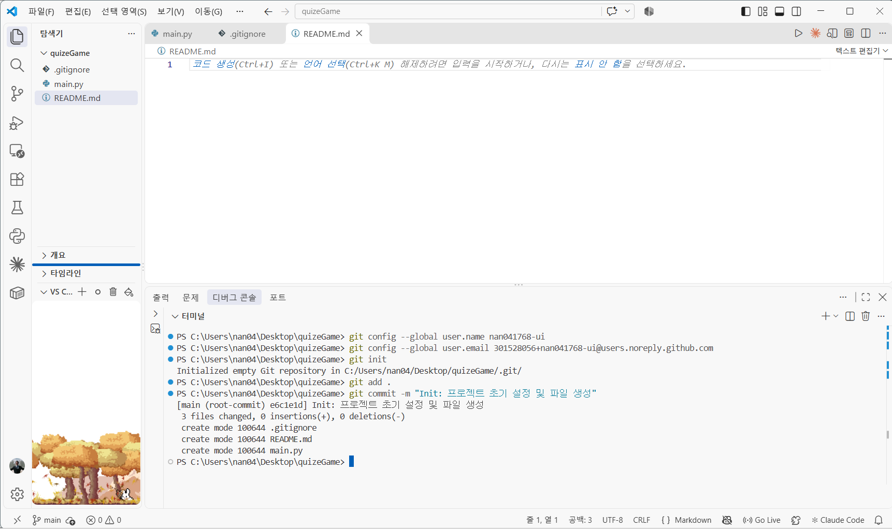
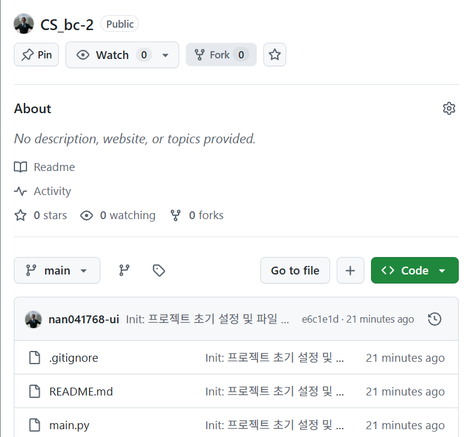

# 파이썬 알아보기

## 0. 초기 설정

- `git init` 이제 이 폴더의 변경 사항을 Git이 추적함
- 파일 생성하기 (3개)
   1. `main.py` (코드를 작성할 메인 파일)
   2. `.gitignore` (Git이 무시할 파일을 지정, 파일명 앞에 점(".") 주의)
   3. `README.md` (프로젝트 설명서)
- `git add .` 모든 파일을 기록할 준비
- `git commit =m "Init: 프로젝트 초기 설정 및 파일 생성"`

## 1. GitHub 원격 저장소 연결
- New Repository 생성: CS_bc-2



### 트러블슈팅
- 깃허브에서 저장소를 새로 만들 때 'README 파일 추가' 등의 옵션을 체크하여, 내 컴퓨터에는 없는 파일이 깃허브 쪽에 먼저 생성되어 있기 때문에 발생
> Git이 깃허브에 있는 기존 데이터를 날리지 않기 위해 안전장치로 업로드를 차단한 상태
>> 프로젝트 초기 셋팅 단계이므로, 내 컴퓨터(로컬)에 있는 파일들을 기준으로 깃허브를 강제로 덮어쓰는 것이 가장 빠르고 깔끔한 해결책
>> `git push -u origin main --force`

```
PS C:\Users\nan04\Desktop\quizeGame> git push -u origin main
To https://github.com/nan041768-ui/CS_bc-2.git
 ! [rejected]        main -> main (non-fast-forward)
error: failed to push some refs to 'https://github.com/nan041768-ui/CS_bc-2.git'
hint: Updates were rejected because the tip of your current branch is behind
hint: its remote counterpart. If you want to integrate the remote changes,
hint: use 'git pull' before pushing again.
hint: See the 'Note about fast-forwards' in 'git push --help' for details.
```

## 2. 파이썬 코드 작성 1 ( 기본 뼈대 & Quiz Class )
*(main.py 코드 작성)*


